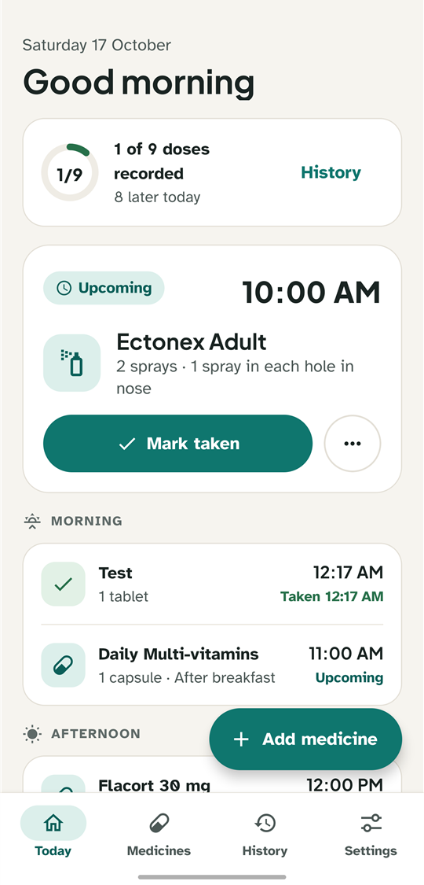
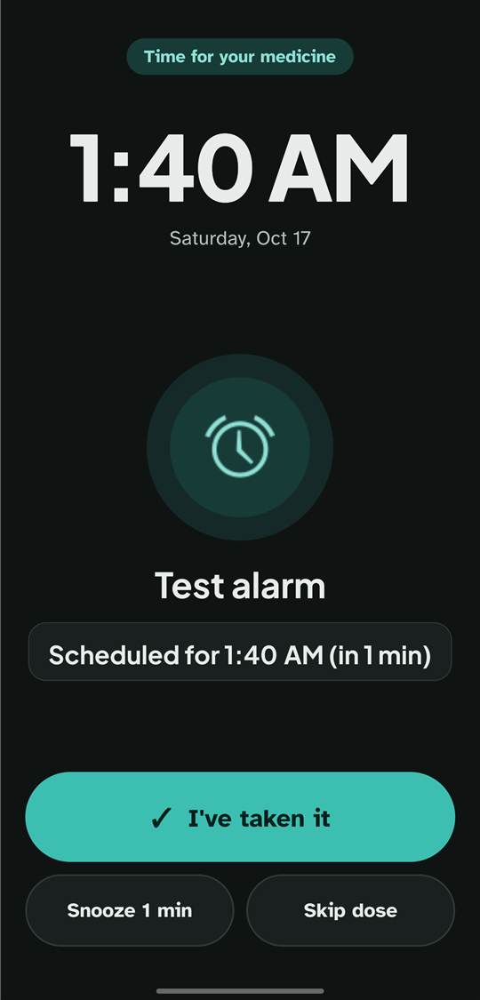
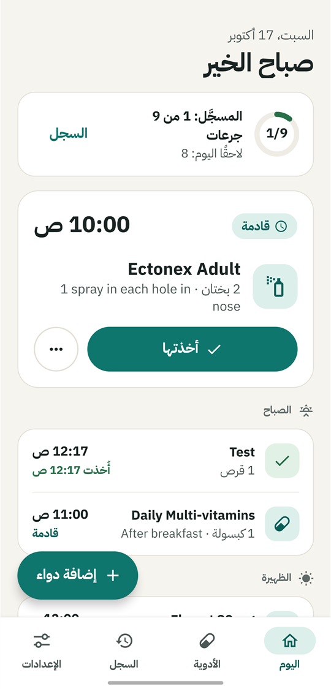
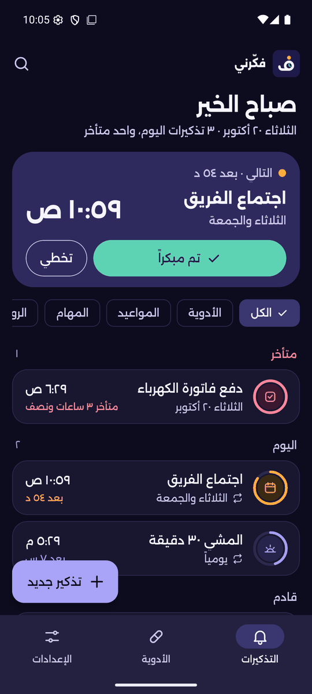
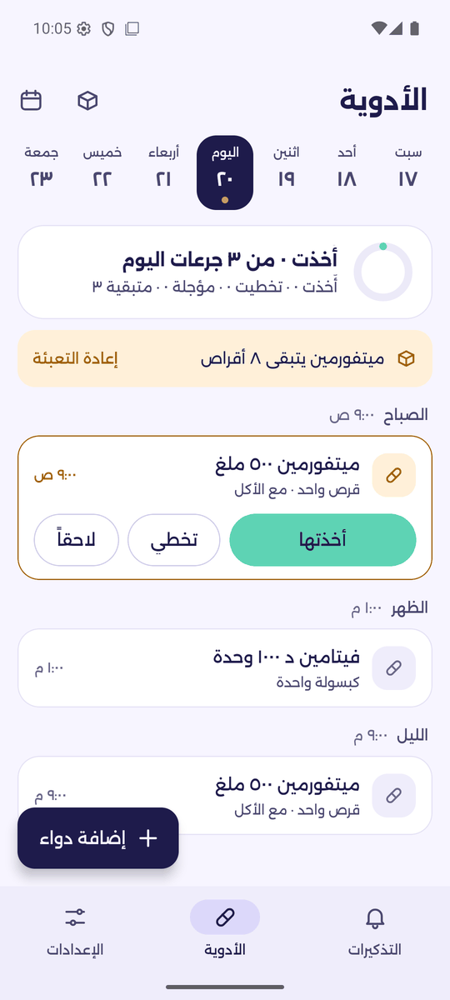
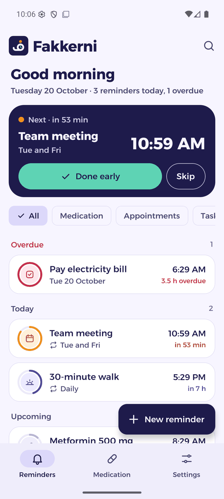

# Amr Ashraf Serag Eldin Ismail · عمرو أشرف سراج الدين إسماعيل

**Senior Full Stack Developer** · Laravel · Next.js · React · Vue.js · Egypt

5+ years building scalable web applications and APIs, and directing AI to ship beyond my own stack.

[**View the portfolio →**](https://amrcs92.github.io/) · [English](https://amrcs92.github.io/en/) · [العربية](https://amrcs92.github.io/ar/) · [Download CV](https://amrcs92.github.io/cv/amr-ashraf-serag-eldin-cv.pdf)

[amrcs1992@gmail.com](mailto:amrcs1992@gmail.com) · [LinkedIn](https://www.linkedin.com/in/amrashrafserageldin92) · [GitHub](https://github.com/amrcs92)

---

## About

I build the backend and the frontend of products that have to hold up in production: commerce APIs with Stripe and Redis, role-based admin dashboards, real-time systems on Laravel Reverb WebSockets, calendars synced with Microsoft Graph, and multi-language marketing sites in Next.js. I currently lead a team at **Monglish International Academy & Edulixa360**: code reviews, architecture, and CI/CD with GitHub Actions.

I'm bilingual, and I build bilingual: Arabic and English, right-to-left done properly.

## Featured work

Two Android apps I designed, directed and shipped end to end.

> **Built with AI, said plainly.** I'm a web developer. These apps were built through an AI-directed workflow, not by hand-writing React Native or Kotlin. I wrote the specs, chose the designs, directed the implementation, tested on real phones, and decided what shipped. My hands-on stack is Laravel and Next.js.

### Dawa2 · دواء — *Your medicines, on time.*

A private, offline medication reminder for Android. Real full-screen alarms keep ringing until you answer **Taken**, **Snooze** or **Skip**. English and Arabic. No accounts, no cloud.

  
  
  

**Built with:** Expo · React Native · Kotlin · SQLite  
[Project site](https://amrcs92.github.io/dawa2-site/) · [Download APK](https://github.com/amrcs92/dawa2-site/releases/latest/download/dawa2.apk)

### Fakkerni · فكّرني — *Everything that matters, on time.*

An Arabic-first alarm and reminder app. Reminders that ring offline, medication with dose tracking and refills, and encrypted backups to Google Drive. Right-to-left throughout. Being prepared for Google Play.

  
  
  

**Built with:** Expo · React Native · Kotlin · SQLite  
[Project site](https://amrcs92.github.io/fakkerni-site/) · [Download APK](https://github.com/amrcs92/fakkerni-site/releases/latest/download/fakkerni.apk)

## How I work with AI

A deliberate workflow, not autocomplete. I own the product decisions; AI implements what I direct, and I review and test it.

| Step | What happens | Tool |
| --- | --- | --- |
| 1. Brainstorm & spec | Shape the idea and write the spec | ChatGPT |
| 2. Pick the UI | Compare design mockups and choose a direction | Claude Design |
| 3. Direct the build | Steer the implementation plan, milestone by milestone | Claude Code |
| 4. Test for real | Run it on the emulator and on my own phone | Emulator + phone |
| 5. Decide what ships | Choose the features, cut the rest, own the release | Me |

## Experience

| Role | Company | When |
| --- | --- | --- |
| **Senior Full Stack Developer** | Monglish International Academy & Edulixa360 | Jun 2024 – Present |
| Full Stack Developer | US Legalization | Jul 2019 – Jul 2024 |
| Junior Software Developer | IT Wolf Solutions | 2017 – 2018 |
| Web Developer / Data Analyst | KAUMEYA Language School | 2015 – 2016 |

Highlights at Monglish & Edulixa360: a Commerce API (Laravel, Redis, Stripe, Swagger, Sentry) · a multi-platform admin dashboard with RBAC and OpenAI integration · a real-time internal system on Laravel Reverb + Next.js · a Marketing Calendar synced with Microsoft Graph / Office 365 · the Monglish and Edulixa360 websites (Next.js, Strapi, next-intl, shadcn/ui).

The full history is in the [portfolio](https://amrcs92.github.io/en/#exp) and the [CV](https://amrcs92.github.io/cv/amr-ashraf-serag-eldin-cv.pdf).

## Skills

| | |
| --- | --- |
| **Backend** | PHP, Laravel, Sanctum, Reverb, Redis, MySQL, Swagger, Stripe, Microsoft Graph |
| **Frontend** | React, Next.js, Vue.js, TypeScript, Tailwind, shadcn/ui, Zustand, Zod |
| **DevOps** | GitHub Actions, Git, Linux, Docker |
| **AI tools** | Claude Code, Claude AI, ChatGPT, MCP |

**Education:** BSc Computer Science, Arab Academy for Science, Technology & Maritime Transport (2014) · Full Stack Internship, ITI (2017)

## About this site

The portfolio is itself a small piece of work:

- **Bilingual for real.** `/en` and `/ar` are full pages, not a few translated words. Arabic mirrors the whole layout right-to-left with logical CSS properties, and direction-aware icons flip.
- **Light and dark.** It follows the visitor's system setting, remembers their choice, and has no flash of the wrong theme on load.
- **Screenshots that match.** Each app shows its Arabic or English, light or dark screens to match how you're viewing the site.
- **Nano particle hero.** A dependency-free canvas field reacts to the cursor and springs back. It never blocks clicks or text selection, pauses when off-screen, thins out on phones, and stays still for reduced-motion users.
- **Static and fast.** It's a Next.js static export served by GitHub Pages, with no backend.

**Stack:** Next.js (App Router) · TypeScript · Tailwind CSS · next-intl · GitHub Actions → GitHub Pages

<b>Maintaining the site</b>

 

Every push to `main` is checked (lint, typecheck, build) and deployed by `.github/workflows/deploy.yml`.

| To change | Edit |
| --- | --- |
| Any text, in both languages | `messages/en.json`, `messages/ar.json` |
| Links (CV, GitHub, LinkedIn, email, app sites, APKs) | `src/site.config.ts` |
| Page structure | `src/app/[locale]/page.tsx` |
| Colours and styles | `src/app/globals.css` |
| Particle behaviour (density, speed, cursor force, lines) | `NANO` in `src/components/NanoField.tsx` |
| CV, screenshots, app icons | `public/cv/`, `public/screenshots/`, `public/apps/` |

New app version: attach the APK to a new release on `dawa2-site` or `fakkerni-site`, named exactly `dawa2.apk` or `fakkerni.apk`. The Download APK buttons always serve the latest.

Local preview: `npm install`, then `npm run dev` and open `http://localhost:3000/en/`.

